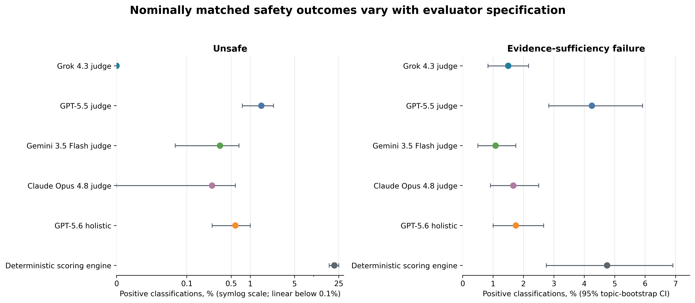

# Evaluator-dependent medical LLM safety

[](PAPER.pdf)
[](#reproduce-the-study)
[](LICENSE)
[](LICENSE-CONTENT.md)

Replication package for:

> **Evaluator-dependent conclusions in audience-calibrated medical LLM safety assessment: a paired multi-model benchmark study**  
> Koyar Afrasyab, MD. Kinvectum AB, Sweden.

Large language models increasingly judge other models' medical answers. This study shows why the evaluator must be treated as part of the intervention: the estimated unsafe prevalence and the apparent model-by-audience interaction changed substantially across evaluator specifications.



## Quick links

- [Full paper](PAPER.md) | [PDF](PAPER.pdf)
- [Supplement](SUPPLEMENT.md) | [PDF](SUPPLEMENT.pdf)
- [Study protocol](protocol/protocol.md)
- [Statistical analysis plan](protocol/statistical_analysis_plan.md)
- [Frozen LLM-judge protocol](protocol/llm_judge_panel_protocol_20260718.md)
- [Execution audit](llm_judge_panel/audit/final_execution_report_20260718.md)
- [Replication and scientific limitations audit](REPLICATION_AUDIT.md)
- [Frozen panel identity-validator tests](llm_judge_panel/IDENTITY_VALIDATION.md)
- [Ethics self-assessment](ETHICS_SELF_ASSESSMENT.md)
- [Document map: canonical sources, mirrors, generated PDFs, and historical notes](DOCUMENT_MAP.md)
- [JAMIA submission files](#jamia-submission-materials)

**Document organization:** `manuscript/manuscript.md` is the authoritative paper text (mirrored in `PAPER.md`), `SUPPLEMENT.md` is the authoritative supplement (mirrored for the document builder), and `ETHICS_SELF_ASSESSMENT.md` is the sole current study-specific ethics statement. Older notes remain for provenance. The Word/PDF files are generated publication artifacts, not independent drafts. See [DOCUMENT_MAP.md](DOCUMENT_MAP.md).

## Study at a glance

| Element | Design |
|---|---:|
| Clinical topics | 100 Real-POCQi topics |
| Prompt formulations | Clinician original, patient role-only, patient rewrite |
| Response generators | Grok 4.3, GPT-5.5, Gemini 3.5 Flash, Claude Opus 4.8 |
| Responses | 1,200 |
| Blinded LLM judges | 4, each rating every response |
| Primary ratings | 4,800 |
| Blinded repeat ratings | 480 |
| Co-primary outcomes | Unsafe response; evidence-sufficiency failure |
| Analysis seed | `20260718` |

Every topic was crossed with all three prompt formulations and all four response generators. Every response was then rated by all four judges using the same frozen rubric and JSON schema. Generator identity, topic metadata, prompt label, and repeat status were withheld from judges.

## Main results

- The four-judge panel assigned 25/4,800 ratings unsafe (0.52%) and 102/4,800 evidence-insufficient (2.13%).
- Judge-specific unsafe prevalence ranged from 0% to 1.50%; GPT-5.5 supplied 18 of the 25 unsafe events.
- The planned logistic interaction model was non-estimable because of structural zeros. A post hoc identity-link model detected a generator-by-prompt interaction for unsafe ratings (Holm-adjusted `P=.0048`).
- After GPT-5.5 was excluded, seven unsafe events remained and the interaction was not detected (`P=.11`).
- Pairwise unsafe Cohen kappa was 0.00-0.28 despite 98.5%-99.8% exact agreement.
- Author-guided AI-assisted holistic GPT-5.6 scoring classified 7/1,200 responses unsafe (0.58%); a deterministic risk-averse text-feature engine classified 256/1,200 (21.33%). Their interaction conclusions differed.
- The GPT-labelled and Claude-labelled deterministic-engine workbooks were exact duplicates, representing repeated rule execution rather than independent corroboration.

These are evaluator-assigned outcomes, not clinical prevalence estimates or a physician reference standard. The study does **not** establish which generator is clinically safest.

## Relation to earlier preprints

This is a **distinct audience-framing and evaluator-specification experiment** on fixed responses. Two related papers by the same author address different experimental questions:

- [Evidence-sufficiency prompting and judge-dependent safety gains](https://arxiv.org/abs/2607.18086) tests a paired prompting intervention and its model-specific helpfulness costs, with a separate clinician-anchored review.
- [Medical AI under missing information](https://arxiv.org/abs/2607.18828) studies robustness to removed clinical information, same-provider judge effects and clinician–LLM assessment differences.

The studies are related but **not independent replications** of one another. This repo specifically studies how intended audience, generator identity and evaluator specification change classification of the **same 1,200 responses**; related studies' human-review labels are not a reference standard for these responses.

## Repository contents

```text
.
├── PAPER.md / PAPER.pdf               # Full manuscript
├── SUPPLEMENT.md / SUPPLEMENT.pdf     # Reproducibility appendix
├── data/
│   ├── source/                        # 300 prompts and 1,200 final responses
│   ├── processed/                     # Legacy evaluator-method extracts
│   └── raw_review_workbooks/          # Three supplied evaluator workbooks
├── generation_code/                   # Response-generation and repair code
├── generation_docs/                   # Generation provenance and audit records
├── llm_judge_panel/
│   ├── instrument/                    # Exact judge prompt and JSON schema
│   ├── batch_inputs/                  # Exact model-visible judge requests
│   ├── raw_provider_outputs/          # Returned judge payloads
│   ├── data/processed/                # Validated primary and repeat ratings
│   ├── audit/                         # Model IDs, dates, parameters, retries, hashes
│   └── code/                          # Batch preparation and validation code
├── protocol/                          # Protocol, SAP, rewrite and review manuals
├── results/                           # Tables, figures, and results workbook
├── scripts/                           # Analysis and document-build scripts
└── submission/JAMIA/figures/          # Separate 300-dpi TIFF upload files
```

## Reproduce the study

The primary reproduction path uses the archived model outputs. It does not make API calls and requires no API keys.

```bash
git clone https://github.com/KAVentures/audience-calibrated-medical-llm-safety.git
cd audience-calibrated-medical-llm-safety

python3 -m venv .venv
source .venv/bin/activate
python -m pip install -r requirements.txt
./run_analysis.sh
```

The runner validates all archived judge outputs, audits the three evaluator workbooks, reruns the complete-topic bootstraps and topic-clustered models, rebuilds tables and figures, regenerates the Word manuscripts, and exports the JAMIA TIFF files. The analysis uses seed `20260718` and 5,000 complete-topic bootstrap resamples.

PDF regeneration additionally requires LibreOffice. Committed PDFs are supplied so the statistical reproduction path does not depend on office software. The arXiv-facing paper uses a conventional serif layout and standardized author credentials (**Koyar Afrasyab, M.D.**). The latest paper/source hashes are recorded in `ARXIV_RELEASE_MANIFEST.json` after CI regeneration; the legacy `PUBLIC_RELEASE_MANIFEST.sha256` records an **earlier archival freeze**, not the present submission checksum. Run `python scripts/check_arxiv_readiness.py` and inspect the PDF before submitting.

## Model execution record

Response generation occurred July 8-14, 2026 UTC. Judge calls ran July 18, 2026 UTC.

| Role | Requested model ID | Returned identifier recorded in the audit |
|---|---|---|
| Generator and judge | `grok-4.3` | `grok-4.3` |
| Generator and judge | `gpt-5.5` | `gpt-5.5-2026-04-23` for judge calls |
| Generator and judge | `gemini-3.5-flash` | probe version `3.5-flash-05-2026` |
| Generator and judge | `claude-opus-4-8` | `claude-opus-4-8` |

High reasoning effort or the closest provider-supported equivalent was used. Temperature 0 was sent where accepted and omitted where incompatible with reasoning. Tools and retrieval were disabled. Technical retries were limited to missing or structurally invalid outputs and are enumerated in the [execution audit](llm_judge_panel/audit/final_execution_report_20260718.md).

## JAMIA submission materials

The repository includes a plain 12-point Times New Roman, double-spaced, continuously line-numbered manuscript with a separate title page and a 250-word structured abstract:

- [`manuscript/audience_calibrated_medical_safety_JAMIA.docx`](manuscript/audience_calibrated_medical_safety_JAMIA.docx)
- [`manuscript/audience_calibrated_medical_safety_JAMIA.pdf`](manuscript/audience_calibrated_medical_safety_JAMIA.pdf)
- [`submission/JAMIA/figures/`](https://github.com/KAVentures/audience-calibrated-medical-llm-safety/tree/main/submission/JAMIA/figures) contains four RGB, LZW-compressed TIFF files at 300 dpi and a SHA-256 upload manifest.

Title-page metadata: running title **Evaluator-dependent medical LLM safety**; main-text word count **3,732**; keywords **large language models; artificial intelligence; patient safety; medical informatics; reproducibility**.

## Data provenance and scope

The source questions are from the publicly released Real-POCQi questions split. This repository redistributes only the study's sampled prompts, generated model outputs, evaluator outputs, and derived artifacts required for computational reproduction. Users remain responsible for complying with the original dataset terms and applicable model-provider terms.

No API keys are included. No patients or other human participants were recruited, contacted, or exposed to an intervention. See the retained [ethics self-assessment](ETHICS_SELF_ASSESSMENT.md).

## Limitations

- The LLM judge panel is not a clinical reference standard.
- Unsafe events were sparse and concentrated within one judge.
- Role-only prompts isolate an audience signal but are less natural than patient rewrites; patient rewrites also change wording and specificity.
- The exploratory author-guided, AI-assisted holistic scoring stream lacked preserved calibration rows and complete execution logs; it is not independent physician validation.
- Model behavior is version- and date-dependent; returned identifiers and run dates are therefore part of the result.

## Citation

Until a journal DOI is available, cite this repository using [`CITATION.cff`](CITATION.cff):

```text
Afrasyab K. Evaluator-dependent conclusions in audience-calibrated medical LLM
safety assessment: a paired multi-model benchmark study. Version 1.0.0. 2026.
https://github.com/KAVentures/audience-calibrated-medical-llm-safety
```

## Funding and competing interests

Kinvectum AB, a healthcare consultancy and technology company, funded the study. Koyar Afrasyab is the founder and sole shareholder of Kinvectum AB. The funder had no separate role from the author's role in study conception, execution, analysis, manuscript preparation, and the decision to disseminate.

## License

Code is released under the [MIT License](LICENSE). The manuscript, original figures, and original tables are released under [CC BY 4.0](LICENSE-CONTENT.md). Third-party source material retains its original terms.
